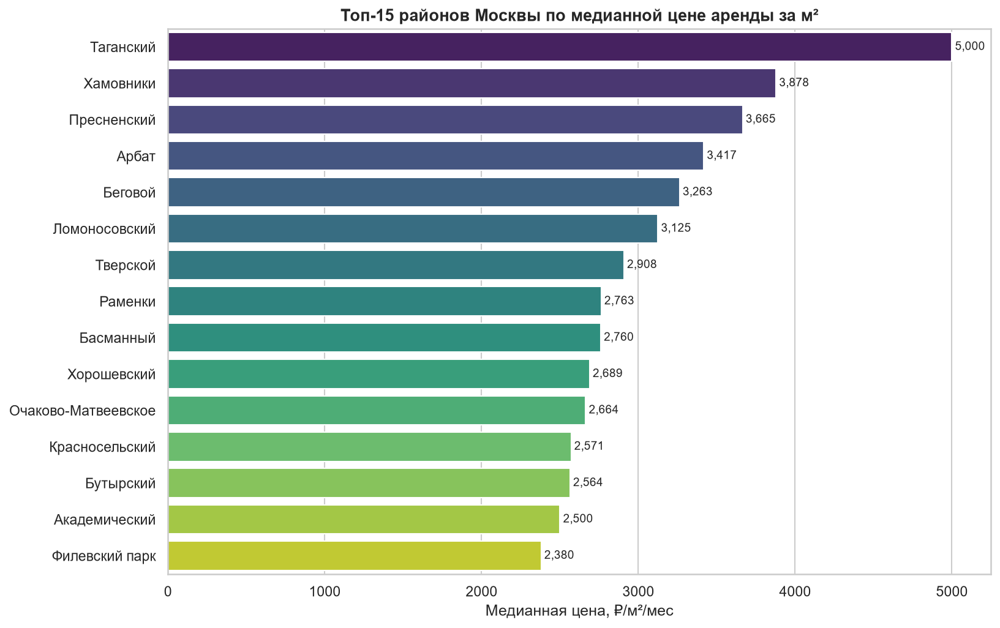
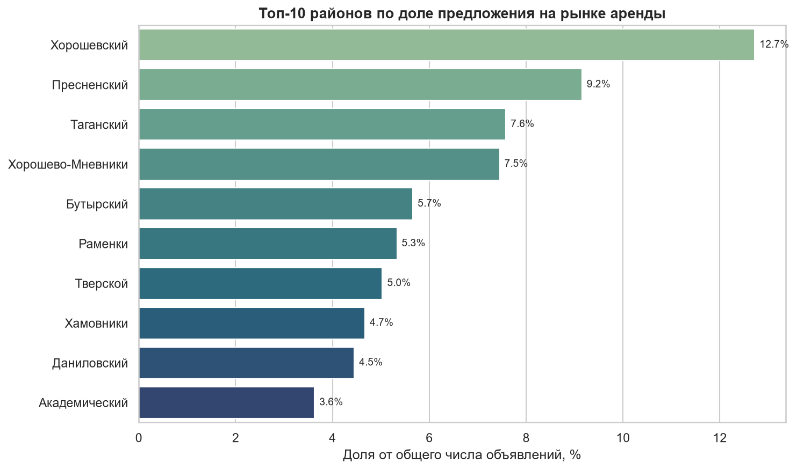
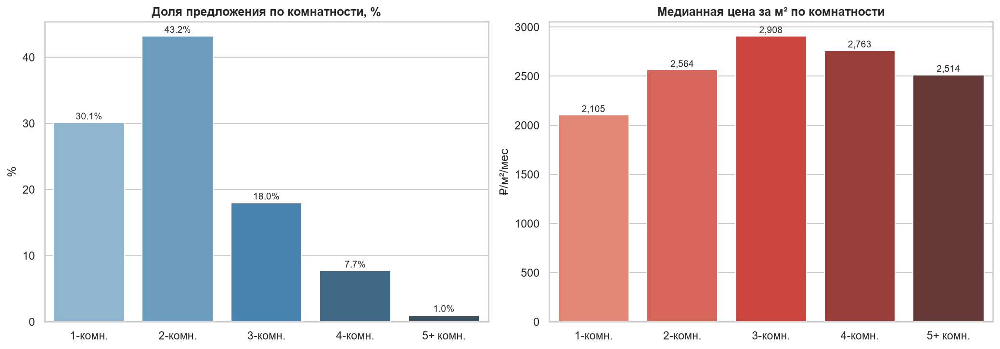
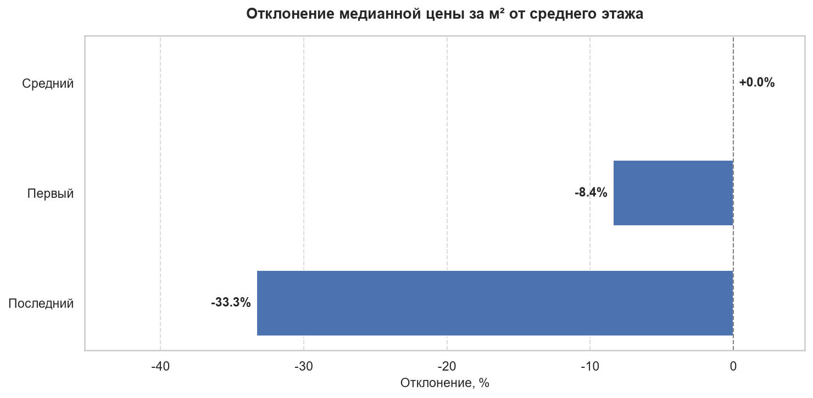
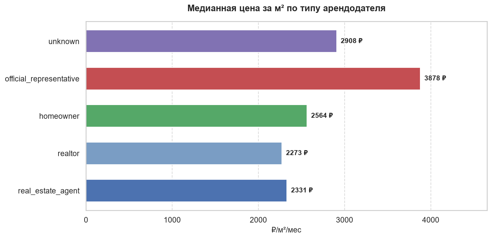

# Анализ рынка аренды жилья в Москве


## 📋 О проекте

End-to-end исследование рынка долгосрочной аренды жилья в Москве: от сбора данных парсингом до интерактивного дашборда. Проект демонстрирует полный цикл работы аналитика — постановку бизнес-задачи, ETL, SQL-анализ с оконными функциями, статистическую проверку гипотез и визуализацию в BI.

**Объём данных:** 5 037 объявлений собрано → 3 967 прошли очистку (79%).  
**Период сбора:** октябрь 2026.  
**Источник:** Циан (cian.ru), долгосрочная аренда, Москва.
**Стек:** Python (Pandas, NumPy, BeautifulSoup, Playwright) · PostgreSQL · Power BI (DAX) · Jupyter

## 🎯 Бизнес-проблема

Агентство недвижимости рассматривает Москву как рынок для расширения, но не имеет данных о том:

- какие районы и ценовые сегменты наиболее привлекательны;
- кто доминирует на рынке (агентства, собственники, застройщики);
- какие характеристики квартир недооценены (этаж, комнатность).

**Цель исследования:** на основе реальных данных о предложении сформировать стратегию выхода агентства на московский рынок аренды и определить приоритетные сегменты.

## 📊 Ключевые результаты

### Портрет рынка

- **Медианная квартира:** 1–2-комнатная, 47 м², **105 000 ₽/мес** (≈2 500 ₽/м²).
- **Средняя цена — 198 296 ₽**, но она в **1,9 раза** выше медианы: рынок сильно скошен вправо (несколько премиум-лотов за 500 000–1 000 000 ₽ тянут среднее вверх). Для принятия решений опираемся на медиану.
- **Ценовые сегменты (квартили):** Q1 — 50 000 ₽, Q2 — 100 000 ₽, Q3 — 150 000 ₽, Q4 — 470 000 ₽.

### География

- Топ-10 районов аккумулируют **~66% предложения**.
- **Премиум-кластер:** Таганский (5 000 ₽/м²), Хамовники (3 878 ₽/м²), Пресненский (3 665 ₽/м²), Арбат (3 417 ₽/м²).
- **Сбалансированный лидер:** Пресненский — 2-е место и по цене, и по объёму предложения (9,2%). Оптимальная точка входа для агентства.
- **Массовая конкуренция:** Хорошевский — 12,7% всего рынка, но 10-е место по цене (2 689 ₽/м²).




### Характеристики квартир

- **Комнатность:** 73% рынка — 1–2-комнатные. Пик цены за м² — у 3-комнатных (2 908 ₽/м²).
- **Этаж:** первый этаж дешевле на **8,4%**, последний — на **33,3%**. Последний этаж — самый недооценённый сегмент.




### Тип арендодателя

- **Агентства и риелторы контролируют ~78% рынка.** Прямые собственники — только **9,9%**.
- **Парадокс цены:** собственники выставляют квартиры на **10% дороже за м²**, чем агентства (2 564 vs 2 331 ₽). Агентства заинтересованы в скорости сделок, поэтому рекомендуют арендодателям дисконт.
- **Премиум-сегмент:** `official_representative` — 7,8% рынка, но цена за м² на **66% выше** массового (3 878 ₽).



## 💡 Рекомендации для бизнеса

**Трёхуровневая стратегия выхода на рынок:**

| Сегмент | Доля портфеля | Районы | Фокус |
|---|---|---|---|
| **Ядро** | 60% | Хорошевский, Хорошево-Мневники, Бутырский | Оборот и скорость сделок |
| **Маржинальный** | 30% | Пресненский, Раменки | Максимум маржи при разумном риске |
| **Премиум** | 10% | Хамовники, Арбат, Тверской | Эксклюзивные лоты, длинные сделки |

**Тактические рекомендации:**

- Работать с **последними этажами** старого фонда — недооценённый сегмент (дисконт 33%). Маркетинговая упаковка «видовых квартир» позволяет поднять ставку на 10–15%.
- Развивать направление **`official_representative`** — премиум с меньшей конкуренцией среди агентств.
- Использовать **данные как аргумент в переговорах** с арендодателями: например, для первого этажа — просить скидку 8–10% к рыночной ставке.

## 🧰 Стек технологий

| Слой | Технологии |
|---|---|
| **Сбор данных** | Python (Requests, BeautifulSoup, cianparser + Playwright) |
| **ETL** | Pandas, NumPy, регулярные выражения |
| **Хранение** | PostgreSQL, SQLAlchemy, DBeaver |
| **Анализ** | SQL (оконные функции, CTE, JOIN, PERCENTILE_CONT, NTILE) |
| **Визуализация** | Matplotlib, Seaborn, Jupyter Notebook |
| **BI** | Power BI (DAX, Power Query) |

## 🛠 Методология

1. **Сбор данных** — `scripts/scraper.py`  
   Парсинг 180 страниц Циан через browser automation (Playwright) для обхода антибот-защиты. 5 037 объявлений сохранены в `data/raw/`.

2. **Очистка и подготовка** — `notebooks/01_data_cleaning.ipynb`  
   Приведение типов, отсечение выбросов (цены за пределами 20 000–1 000 000 ₽, площади 10–400 м²), создание признаков `price_per_sqm`, `floor_ratio`, `is_first_floor`, `is_last_floor`. Результат: 3 967 строк в `data/processed/`.

3. **Загрузка в PostgreSQL** — `scripts/load_to_db.py`  
   Загрузка в таблицу `rent_offers` с индексами по `district`, `rooms`, `author_type`.

4. **SQL-анализ** — `notebooks/02_sql_analysis.ipynb`  
   8 аналитических запросов с бизнес-интерпретацией:
   - Общая картина рынка
   - Рейтинг районов (`RANK`, `LAG` — оконные функции)
   - Доля предложения (`SUM OVER`)
   - Эффект этажа (`CASE` + `CROSS JOIN` + подзапрос)
   - Комнатность
   - Тип арендодателя
   - Топ ЖК
   - Квартили цен (`NTILE`)

5. **Визуализация** — дашборд в Power BI (`powerbi/rental_market.pbix`)

## 📁 Структура проекта
```
moscow-rental-market-analysis/
├── data/
│   ├── raw/                  # Сырые данные (не коммитятся)
│   └── processed/            # Очищенные данные (не коммитятся)
├── images/
│   └── sql_analysis/         # Визуализации из ноутбуков
├── notebooks/
│   ├── 01_data_cleaning.ipynb
│   └── 02_sql_analysis.ipynb
├── powerbi/
│   └── rental_market.pbix    # (появится после добавления Power BI)
├── scripts/
│   ├── scraper.py
│   └── load_to_db.py
├── .env.example
├── .gitignore
├── README.md
└── requirements.txt
```

## 🚀 Как запустить
1. Клонируйте репозиторий.
2. Установите зависимости: `pip install -r requirements.txt`
3. Скопируйте `.env.example` → `.env` и впишите параметры БД.
4. Создайте БД `rental_market` в PostgreSQL.
5. Запустите `python scripts/scraper.py` — соберёт сырые данные.
6. Выполните `notebooks/01_data_cleaning.ipynb` — подготовит данные.
7. Запустите `python scripts/load_to_db.py` — загрузит в PostgreSQL.
8. Выполните `notebooks/02_sql_analysis.ipynb` — SQL-запросы.
9. Откройте `powerbi/rental_market.pbix` — дашборд.

## ⚠️ Ограничения анализа
1. ЖК-сегмент. Поле residential_complex заполнено в 4% объявлений. В выборке только 2 ЖК с ≥3 объявлениями — недостаточно для статистически значимых выводов.
2. Период сбора. Данные — моментальный срез, без исторической динамики. Для оценки трендов и сезонности нужна регулярная выгрузка.
3. Верхняя граница цены. Фильтр 1 млн ₽ отсекает сверхпремиум-сегмент (3–5 млн ₽/мес), который важен для элитной аренды.
4. География. Только Москва — выводы не экстраполируются на Московскую область и регионы.

## 🗺 Что дальше
Возможные направления развития проекта:
- Историческая динамика — регулярный парсинг раз в месяц для анализа трендов.
- A/B-анализ — скорость сдачи объекта в зависимости от ставки (по времени жизни объявления).
- Геопространственный анализ — расстояние до метро, школы, парка как фактор цены.
- ML-модель — предсказание рыночной ставки по параметрам квартиры (регрессия, gradient boosting).

## 👤 Автор
Сухих Елизавета, Junior Data Analyst
- GitHub: [@veta-suhih](https://github.com/veta-suhih)
- LinkedIn: [@vetasuhih](https://www.linkedin.com/in/vetasuhih)
- Telegram: [@veta_suhih](https://t.me/veta_suhih)
- Email: [veta.suhih@gmail.com](mailto:veta.suhih@gmail.com)

## 📄 Лицензия
MIT — используйте код свободно в учебных и коммерческих целях.